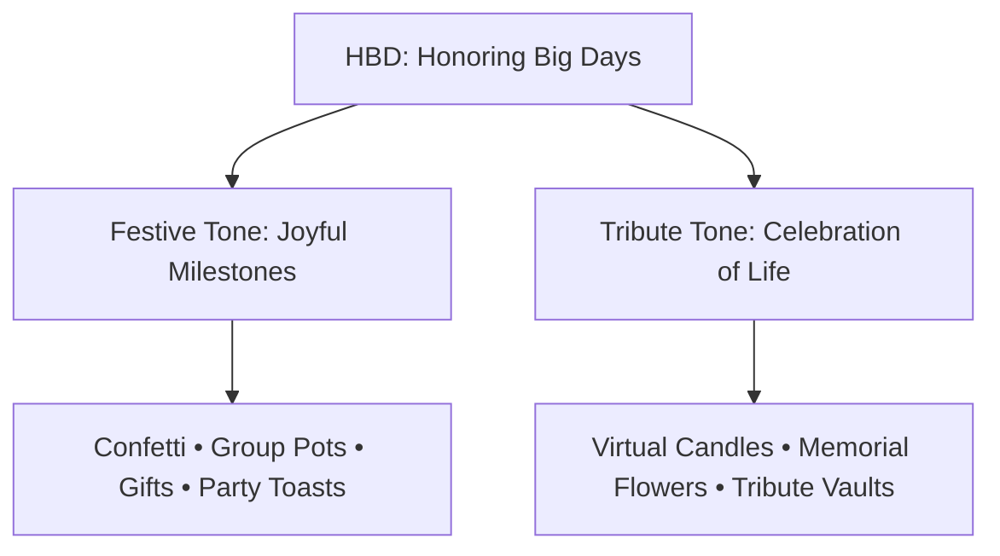
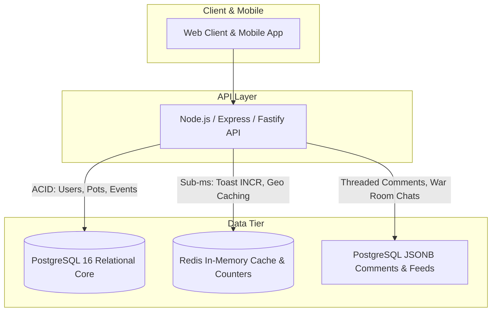

# HBD (Honoring Big Days) — Unified Master Implementation Plan

## 1. Executive Summary & Brand Positioning

### Brand Defense: Defending "HBD"
* **Primary Rebranding Definition**: **"Honoring Big Days"** (with cultural resonance: *Honor • Belonging • Destiny*).
* **The "Celebration of Life" Paradigm**: Tributes and remembrances are not gloomy obituaries; they are celebrations of human impact, legacy, and memory. The acronym HBD stays universally intact, modern, and emotionally uplifting across every milestone from birth to legacy.
* **The Dual-Tone Experience Engine**:
  * **Festive Tone (`FESTIVE`)**: Dynamic champagne gold, confetti blasts, celebratory music, digital party poppers, birthday cakes, and joyful toasts.
  * **Tribute Tone (`TRIBUTE`)**: Serene platinum slate, dignified memorial candles, tribute walls, floral deliveries, memory vaults, and reflective moments.

---

## 2. Global Calendar & Geolocation Strategy

### Core Principles
1. **Zero Empty Days**: Every day of the year globally features meaningful events: international observances, historical breakthroughs, iconic cultural birthdays, or community causes.
2. **Intelligent Scoping (No Clutter)**:
   * **Default View**: Anchored directly to the user's **Country of Residence** + their opt-in **Interests** and **Traditions**, with personal relationship circles (`My People`) given top priority.
   * **Multi-Scope Filter**:
     * `Family & Friends`: Intimate inner circle.
     * `Local City`: Hometown celebrations and local heroes.
     * `Country Level`: National holidays, independence days, local heritage.
     * `Pan-Continental`: Regional unity days (e.g. Africa Day, Europe Day).
     * `Worldwide Observance`: UN days, global breakthroughs, universal icons.
3. **Multi-Calendar Engine (Solar vs Variable Lunar)**:
   * Fixed Gregorian/Solar dates recur automatically on identical `(month, day)`.
   * Floating Lunar/Astronomical dates (Eid al-Fitr, Eid al-Adha, Easter Sunday, Diwali, Yom Kippur, Lunar New Year) are precomputed into an `event_occurrences` table (2025–2035) to eliminate runtime recalculation overhead.

---

## 3. Unified Category & Visual Design Tokens

### Pillar 1: Celebration Types (`CelebrationCategory`)
| Category | Label | Signature Color | Primary Use Cases |
| :--- | :--- | :--- | :--- |
| `BIRTHDAY` | People & Birthdays | Royal Blue (`#2563EB`) | Personal birthdays, age milestones |
| `BEGINNING` | Beginnings & Startups | Emerald Green (`#10B981`) | Startup launches, graduations, housewarmings |
| `MILESTONE` | Milestones & Triumphs | Warm Amber (`#F59E0B`) | Recovery/sobriety, health remissions, career leaps |
| `ANNIVERSARY` | Anniversaries & Weddings | Rose Red (`#E11D48`) | Marriages, corporate foundation days |
| `COMMUNITY` | Community Heroes & Idols | Amethyst Violet (`#7C3AED`) | Unsung mentors, historical champions, icons |
| `FAITH` | Faith & Sacred Heritage | Celestial Indigo (`#6366F1`) | Eid, Easter, Diwali, Yom Kippur, Wesak, Hanukkah |
| `TRIBUTE` | Tributes & In Memoriam | Platinum Slate (`#475569`) | Posthumous legacies, passing anniversaries, memorials |

### Pillar 2: Inspiration Fields (`InspirationDomain`)
* `TECH_BUSINESS`: Founders, breakthrough products, space tech.
* `MUSIC_ARTS`: Legendary albums, artists, cultural festivals.
* `SPORTS_PIONEERS`: Historic records, athletic icons, championships.
* `HUMANITARIAN_LEADERS`: Civil rights champions, peace prize laureates.
* `SCIENCE_DISCOVERY`: Inventions, medical discoveries, scientific frontiers.
* `EARTH_NATURE`: Conservation days, wildlife awareness, planetary health.
* `FAITH_PHILOSOPHY`: Sacred wisdom, spiritual heritage, world faiths.

### Pillar 3: Scopes & Circles (`CalendarGeographicScope`)
* `CIRCLE` | `LOCAL` | `COUNTRY` | `CONTINENT` | `GLOBAL`

---

## 4. Backend & Database Architecture (Hybrid System)

### Why Hybrid?
* **Relational PostgreSQL Core**: Essential for financial integrity (Surprise Pots, money pools, gifting checkout), strict user identity verification (anti-duplication civil hashes), relationship graphs, and Row-Level Security for Stealth War Rooms.
* **In-Memory Redis Cache & Atomic Counters**: Millions of real-time "Lift a Toast" counter increments (`INCR toast:event_id`), real-time pub/sub notifications, and sub-millisecond cached calendar matrices by geo-key (`cal:2026:10:US`).
* **Document / PostgreSQL `JSONB`**: Unstructured rich media chat in secret war rooms, threaded comment trees, and dynamic user wishlists without costly table joins.

### Core Schema Models Required
1. `users` & `user_passports`: Identity, KYC status, verified birthdate, country code.
2. `user_preferences`: Opt-in cultural traditions (`traditions: text[]`) and memorial toggle (`showTributes: boolean`).
3. `calendar_events`: Master catalog of 365+ global celebration entries.
4. `event_occurrences`: Precomputed annual dates (year, month, day, exact_date) for variable lunar and fixed solar events.
5. `stealth_war_rooms`: Row-Level Security protected surprise planning rooms where the celebrant is cryptographically blind to proceedings.
6. `group_pots`: Financial ledger for crowdfunding gifts, escrow statuses, and transaction receipts.
7. `event_reactions`: High-scale user reactions with Redis write-through cache.

---

## 5. Commercial & Monetization Mechanics

Every celebration card dynamically matches a commercial intent driver:
1. **`GIFT` (Universal Gift Engine)**: Direct checkout for physical flowers, bespoke cakes, artisanal hampers, or cross-border merchant deliveries.
2. **`POT` (Surprise War Room Crowdfunding)**: Pooled cash collection among friends/family with verified payment gateways (Stripe, Mobile Money, Apple Pay).
3. **`EXPERIENCE` (Celebration Bookings)**: VIP package tiers (`MINI`, `CLASSIC`, `PREMIUM`, `SIGNATURE`, `GLOBAL`) connecting users to local event planners and photographers.
4. **`TOAST` (Micro-Sponsorships & Digital Flowers)**: Virtual memorial candles, champagne toasts, and community badges.

---

## 6. End-to-End Implementation Roadmap

### Phase Summary & Status

| Phase | Description | Status | Scope |
| :--- | :--- | :--- | :--- |
| **Phase 1** | Shared Domain Types & Contracts | **COMPLETED** | [shared/types.ts](file:///c:/Users/PC%20USER/Desktop/HBD-FOUNDATION/shared/types.ts) |
| **Phase 2** | Curated Global 365-Day Dataset | **COMPLETED** | [calendarData.ts](file:///c:/Users/PC%20USER/Desktop/HBD-FOUNDATION/client/src/data/calendarData.ts) |
| **Phase 3** | Web Client UI, Non-Modal Filters & Tone Engine | **COMPLETED** | [HBDaysView.tsx](file:///c:/Users/PC%20USER/Desktop/HBD-FOUNDATION/client/src/components/HBDaysView.tsx) |
| **Phase 4** | Mobile Screen Layout & Category Chips | **COMPLETED** | [DatesScreen.tsx](file:///c:/Users/PC%20USER/Desktop/HBD-FOUNDATION/mobile/src/screens/DatesScreen.tsx) |
| **Phase 5** | Mobile Traditions Onboarding, Profile & Tone Engine | **COMPLETED** | [AuthModalScreen.tsx](file:///c:/Users/PC%20USER/Desktop/HBD-FOUNDATION/mobile/src/screens/AuthModalScreen.tsx), [ProfileScreen.tsx](file:///c:/Users/PC%20USER/Desktop/HBD-FOUNDATION/mobile/src/screens/ProfileScreen.tsx) |
| **Phase 6** | Server Prisma Schema & Hybrid DB Engine | **COMPLETED** | [schema.prisma](file:///c:/Users/PC%20USER/Desktop/HBD-FOUNDATION/server/prisma/schema.prisma) |
| **Phase 7** | Verification, Build Sanity & End-to-End Test | **COMPLETED** | Full Client, Mobile & Server builds passed (0 errors) |

---

## 7. Execution Checklist & Verification Results

* [x] **Zero Empty Days**: Curated global 365-day dataset populated with solar and variable lunar dates.
* [x] **Tone Switch**: Dignified tribute mode implemented (`TRIBUTE` triggers virtual memorial candle, platinum slate theme `#475569`, memory tributes; `FESTIVE` triggers confetti and party toasts).
* [x] **Non-Modal Category Filters**: Inline anchored dropdowns with signature colors implemented on both Web and Mobile.
* [x] **Safe-Area Mobile Ergonomics**: Android notch/status bar top clearance and bottom navbar clearance maintained across all mobile views without global wrapper padding.
* [x] **Sacred & Cultural Heritage Onboarding**: 7-step onboarding flow with skippable cultural traditions and memorial alerts in [AuthModalScreen.tsx](file:///c:/Users/PC%20USER/Desktop/HBD-FOUNDATION/mobile/src/screens/AuthModalScreen.tsx) and customizable in [ProfileScreen.tsx](file:///c:/Users/PC%20USER/Desktop/HBD-FOUNDATION/mobile/src/screens/ProfileScreen.tsx).
* [x] **Prisma Database Schema**: Extended with `FAITH`, `TRIBUTE`, `CalendarEvent`, and `EventOccurrence` models, validated via `prisma validate`.
* [x] **Clean Compilation**: Client (`vite build`), Mobile (`tsc --noEmit`), and Server (`tsc`) all compiled with exit code 0.

